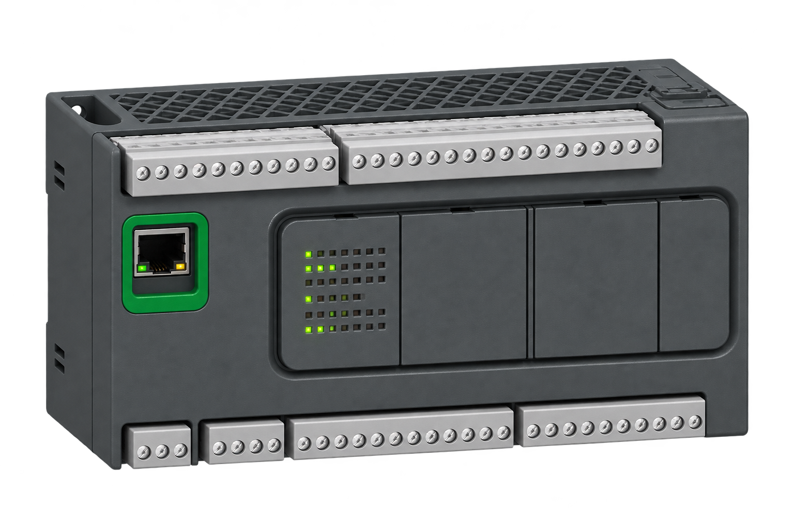

<p align="center">
  
</p>

<h1 align="center">M200 C++ to Ladder</h1>

<p align="center">
  <strong>A C++ to Ladder compiler for the Schneider Electric Modicon M200 TM200CE40T PLC.</strong><br>
  Write control logic as code, inspect it in the official editor, and explore how a PLC program works.
</p>

<p align="center">
  <a href="#quick-start">Quick start</a> ·
  <a href="#how-it-works">How it works</a> ·
  <a href="#current-coverage">What works today</a> ·
  <a href="#contributing-and-supporting-other-plcs">Contribute</a> ·
  <a href="#documentation">Documentation</a>
</p>

> **Built for the TM200CE40T.** Write PLC logic in C++, generate a Ladder project, and inspect it in Schneider Electric’s official software. Other models, project configurations, and physical-controller behavior require separate validation. This independent project is not certified or endorsed by Schneider Electric.

[Official TM200CE40T product page](https://www.se.com/in/en/product/TM200CE40T/controller-modicon-m200-40-io-transistor-source-ethernet/)

## Why this project exists

A **PLC** is a small industrial computer that repeatedly reads inputs, runs a control program, and updates outputs. Many PLCs are programmed in **Ladder**, a visual language made of electrical-style diagrams. Ladder is useful for inspection and maintenance, but some algorithms can be easier to write and review as text.

**M200 C++ to Ladder** explores a bridge between the two. You write a supported subset of C++ using a small PLC library; the tool translates it into controller instructions and can place them in a project that opens in **EcoStruxure Machine Expert Basic**, Schneider Electric's programming software. You can then inspect the Ladder and use the official software for the next steps.

The tool also has a reverse path: it can read supported project instructions and reconstruct C++ for inspection. It reads the real program, rather than retrieving a copy of the original source hidden in the file.

This started with a real [Natal da Liberdade lighting project](docs/GOAL.md), where readable algorithms and compact generated Ladder mattered. The longer-term aim is broader functional coverage of the same controller, with a foundation that contributors can study and extend.

## How it works

```text
 Your C++ + PLC library                  An existing project for the target PLC
          │                                               │
          ▼                                               ▼
  Read and check the code ──► Generate instructions ──► Build a candidate .smbp
                                        │                         │
                                        ▼                         ▼
                              Inspect / simulate locally   Open in Schneider software
                                                                  │
                                                                  ▼
                                                      Inspect Ladder and validate
```

1. **Write a scan.** A function named `scan()` describes one pass of the control logic. The PLC repeats that pass as it runs.
2. **Compile.** Clang reads the C++ structure; the compiler translates the supported parts into PLC instructions, assigns resources, and checks known constraints.
3. **Explore locally.** Inspect the instructions and reports, run sample input traces, and compare local execution routes.
4. **Create a project.** With a suitable `.smbp` template, the exporter produces a candidate project containing supported instructions and Ladder graphics.
5. **Use the official editor.** Open and validate the generated project in Machine Expert Basic. Transfer to a PLC, when appropriate, is performed through that software.

A local check is useful evidence, **not a guarantee of behavior on every editor version, configuration, or physical controller**. The CLI does not automatically transfer programs, update firmware, or switch real outputs.

### What a scan looks like

```cpp
#include <plc.hpp>

plc::Clock blink{500};

void scan() {
    bool on = blink.update(true);
    plc::output(0, on);
    plc::output(1, !on);
}
```

This example alternates two outputs. `scan()` is called repeatedly; the clock keeps its state between scans and does not pause the controller while it waits. The 500 ms value is a **nominal half-period**: actual behavior depends on the PLC's timer resolution and scan timing. See the runnable [blink example](examples/blink.cpp).

This is **restricted C++**, not a general-purpose C++ runtime. The supported language, operations, memory, and device resources are deliberately bounded; unsupported constructs should be reported as errors. A compiler limitation does not imply that the physical PLC itself lacks that capability.

## Target and compatibility

| | Current status |
|---|---|
| **Controller target** | Schneider Electric **Modicon Easy M200 TM200CE40T**; 24 built-in digital inputs, 16 transistor outputs, Ethernet. [Product details](https://www.se.com/in/en/product/TM200CE40T/controller-modicon-m200-40-io-transistor-source-ethernet/). |
| **Project format** | Supported `.smbp` projects for **EcoStruxure Machine Expert Basic**, generated using an authentic project template for this exact target. |
| **Other controllers** | Not supported or validated yet, including other M200 variants. Sharing a product family or editor does not establish compatibility. |
| **Local tools** | Python 3.9+ and Clang with C++17 support. The recorded development environment is macOS with Apple Clang; other environments require their own checks. |
| **Editor and hardware** | Generated projects are intended for inspection in Machine Expert Basic; device behavior depends on the target and configuration. |

Do not change a project file's model name to make another controller appear supported. Inputs, outputs, firmware, resource limits, project format, and behavior must be established for each target. See [supporting another PLC](#contributing-and-supporting-other-plcs).

## Quick start

### 1. Get the tools

Install **Python 3.9 or newer** and **Clang with C++17 support**. `make` is needed for the repository's local validation targets. The Python toolchain itself uses the standard library.

```sh
git clone https://github.com/viniciusczanini/m200-cpp.git
cd m200-cpp

python3 --version
clang++ --version
./m200c --help
```

Run the commands below from the repository root. Use `M200_CLANG=/path/to/clang++` if you need to select a specific Clang executable. No PLC or Windows installation is needed for local compilation and trace checks.

### 2. Compile and try the example locally

```sh
# Generate instructions, an audit source file, and reports.
./m200c compile examples/blink.cpp -o output/blink

# Compare original C++, local PLC instructions, and reconstructed C++ on a trace.
./m200c check examples/blink.cpp --trace examples/trace.json

# Inspect the local model or run the same trace.
./m200c inspect output/blink/program.m200.json
./m200c simulate output/blink/program.m200.json --trace examples/trace.json
```

The output includes `program.il` (readable instructions), `program.m200.json` (the local model), `program.audit.cpp` (reconstructed C++), a source map, and a resource report. **There is no `.smbp` file unless you provide a compatible template**, as shown next.

`check` executes the supplied C++ as native code on your computer; use trusted source. Its trace comparison covers the reported outputs and shares some modeling assumptions with the local executor. It is not a substitute for official simulation or hardware testing.

### 3. Generate a project for the official editor

Start from an authentic TM200CE40T project created in Machine Expert Basic, with the hardware and settings appropriate to your setup. For a first experiment, this repository includes an [editor-created baseline and provenance](tests/fixtures/official_tm200ce40t_memory.provenance.json):

```sh
./m200c compile examples/blink.cpp \
  --template tests/fixtures/official_tm200ce40t_memory.smbp \
  -o output/blink-project
```

The new file is `output/blink-project/program.smbp`. Open it in Machine Expert Basic, inspect the Ladder, check the controller configuration and messages, and validate the behavior in the official simulator. Use a project matching your own device and installation as the template for your application; the included baseline is an example, not a replacement for your configuration. The input template is not modified.

Preserve a backup of any existing controller program before working with a real installation. Validate the exact candidate and hardware behavior separately before considering a transfer. The [getting started guide](docs/GETTING_STARTED.md) explains the artifacts, trace format, template requirements, and editor workflow.

### 4. Read a supported project back as C++

```sh
./m200c decompile output/blink-project/program.smbp -o output/project-audit.cpp
```

The result is **reconstructed audit C++**, not necessarily your original source: names, formatting, and high-level structure may not be recoverable. For `.smbp` input, the command also writes a configuration sidecar; keep it with the reconstructed source. Unsupported project constructs are rejected instead of being silently presented as understood. See [reverse conversion](docs/GETTING_STARTED.md#6-reverse-the-actual-program).

## Current coverage

These are implemented **subsets** with different levels of evidence, not complete support for every option in the editor.

| Area | What you can explore | Where to go next |
|---|---|---|
| **Digital I/O and logic** | Inputs and outputs, Boolean state, conditions, edges, and supported scan behavior | [Boolean semantics](docs/G01-BOOLEAN.md) |
| **Numbers and control flow** | Typed numbers, comparisons, fixed arrays, supported loops, branches, and early return | [Architecture and semantics](docs/ARCHITECTURE.md) · [Numeric guide](docs/NUMERIC.md) |
| **Timers and counters** | TON, TOF, TP, clocks, multiple timers, and native counter subsets | [Timers](docs/TIMERS-G07.md) · [Counters](docs/capabilities/COUNTERS.md) |
| **Sequences and subroutines** | Supported FIFO/LIFO, shift, step, drum, and subroutine profiles | [Registers](docs/REGISTERS.md) · [Sequences](docs/NATIVE-SEQUENCES.md) · [Subroutines](docs/SUBROUTINES.md) |
| **RTC and schedules** | Calendar/system-word operations and supported schedule routes | [RTC and scheduling](docs/RTC.md) |
| **Modbus** | Local models and selected project-export profiles for READ, WRITE, and WRITE_READ operations | [Modbus guide and limitations](docs/MODBUS.md) |
| **Project inspection and reverse** | Supported `.smbp`/program-model import and reconstruction from actual instructions | [Format evidence](docs/FORMAT.md) · [Getting started](docs/GETTING_STARTED.md#6-reverse-the-actual-program) |

Timer modes, communication profiles, special I/O, resource allocation, lifecycle behavior, and project configurations have explicit limits. In particular, a locally modeled Modbus operation does not by itself demonstrate a successful physical communication exchange. See the [capability inventory](docs/capabilities/README.md) and the [architecture guide](docs/ARCHITECTURE.md) for the exact boundaries.

```sh
./m200c capabilities          # Inventory summary and implemented subset
./m200c capabilities HW.HSC   # One documented capability
./m200c capabilities --all    # Full documented catalogue
```

The catalogue also records research and missing capabilities: an item being listed does **not** mean it is implemented or validated.

## Contributing and supporting other PLCs

Contributions are welcome, whether you want to improve the existing target, expand its supported subset, add examples, or investigate another PLC. Please start by describing the exact model, editor and firmware versions, the behavior you want, and the evidence available. Small, reproducible examples and clear expected results are especially useful.

For another controller, a practical contribution would include:

1. **Document the target:** official model and manuals, I/O and memory limits, editor and firmware versions, project format, and required configuration.
2. **Establish semantics:** scan order, initialization, timers, counters, communications, and any differences from the existing model. Similar-looking instructions may behave differently.
3. **Implement explicit target support:** validate resource allocation and project read/write against that target's actual format and official examples; reject unknown forms rather than guessing.
4. **Share a complete contribution:** include representative examples, document supported behavior and limitations, and explain the changes clearly.

The current codebase is a starting point for this work, **not a promise that a new target can be enabled by changing a configuration string**. Relevant starting points:

| Part | Location |
|---|---|
| C++ frontend and SDK | [`m200/frontend.py`](m200/frontend.py) · [`sdk/`](sdk/) |
| Translation, allocation, and local execution | [`m200/lower.py`](m200/lower.py) · [`m200/allocation.py`](m200/allocation.py) · [`m200/il.py`](m200/il.py) |
| Ladder and project format | [`m200/ladder_lowering.py`](m200/ladder_lowering.py) · [`m200/project.py`](m200/project.py) |
| Reverse conversion | [`m200/reverse.py`](m200/reverse.py) |
| Examples and tests | [`examples/`](examples/) · [`tests/`](tests/) |
| Scope, design, and open work | [Architecture](docs/ARCHITECTURE.md) · [Roadmap](docs/ROADMAP.md) · [Full parity goal](docs/PARITY.md) |

This repository currently has no `LICENSE` file; contact the maintainer about reuse terms until one is published.

## Documentation

- **New here?** [Getting started](docs/GETTING_STARTED.md) explains installation, commands, examples, and the official-editor handoff.
- **Want the internals?** [Architecture and semantics](docs/ARCHITECTURE.md), [project format](docs/FORMAT.md), and [optimization](docs/OPTIMIZATION.md) describe the compiler and its constraints.
- **Looking for a feature?** Browse the [capability inventory](docs/capabilities/README.md), [timers](docs/TIMERS-G07.md), [RTC](docs/RTC.md), and [Modbus](docs/MODBUS.md).
- **Planning future work?** See the [current goal](docs/GOAL.md), [roadmap](docs/ROADMAP.md), and [parity contract](docs/PARITY.md).

Schneider Electric, Modicon, and EcoStruxure are names of their respective owners. This independent project is not affiliated with or endorsed by them.
