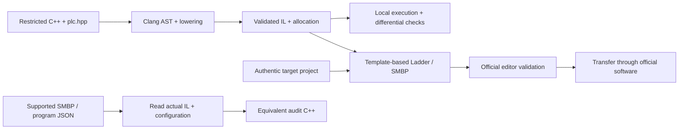

# m200-cpp

**Write PLC logic in C++. Inspect the generated instructions. Recover C++ from the real program.**

An experimental C++ → IL → Ladder/SMBP toolchain for the **Schneider Electric TM200CE40T**. It combines a restricted C++ language, a small PLC SDK, automatic resource allocation, a local instruction executor, and a reverse compiler.

The intended result is a project opened, checked, and transferred by **EcoStruxure Machine Expert Basic**. The reverse path reads the project's actual instructions and configuration; it does not recover a saved copy of the original source.

> **Experimental · partial coverage.** Exact generated projects have run in the official local simulator under Wine: memory/digital I/O, array loops, timer/counter logic, a TON/TP/TOF sequence, numeric diagnostics and early `return;`. The sequence was saved, read back and reopened. One separate diagnostic project's simulator startup crashed and remains under investigation; complete editor and physical TM200CE40T compatibility are unfinished. This independent project has no Schneider Electric certification or endorsement.

[Quick start](#quick-start) · [Workflow](#workflow) · [Current coverage](#current-coverage) · [Validation](#validation) · [Documentation](#documentation)

## Why this project exists

PLC programs should be expressible as readable source code while remaining inspectable in the manufacturer's tools. m200-cpp explores that workflow with explicit scan semantics, typed operations, visible resource costs, and reversible native instructions.

The final goal is **functional equivalence with the identified official TM200CE40T profile**: every algorithm accepted for that profile should have a supported C++ expression and produce an equivalent project. Today's subset is a development milestone. Missing instructions, tasks, peripherals, or exporter features remain toolchain work; they do not establish a limitation of the PLC. See the [full parity contract](docs/PARITY.md).

## Quick start

Requirements: **Python 3.9+**, **Clang with C++17 support**, and `make` for the validation targets. The Python implementation uses only the standard library. The recorded development environment uses macOS and Apple Clang 21; other environments need their own validation.

```sh
git clone https://github.com/viniciusczanini/m200-cpp.git
cd m200-cpp

./m200c compile examples/blink.cpp -o output/blink
./m200c check examples/blink.cpp --trace examples/trace.json
./m200c simulate output/blink/program.m200.json --trace examples/trace.json
```

No package installation, Windows installation, or PLC connection is needed for these local commands. Set `M200_CLANG` to select a different Clang executable. `python3 -m m200` is equivalent to `./m200c` when run from the repository root.

A minimal nonblocking clock:

```cpp
#include <plc.hpp>

plc::Clock blink{500};

void scan() {
    bool on = blink.update(true);
    plc::output(0, on);
}
```

`scan()` runs once per PLC cycle. This clock starts off and uses two native timers plus state. Its nominal 500 ms half-period is subject to timer resolution and scan latency; local simulation does not establish physical timing.

**Without `--template`, compilation produces local IL, JSON, audit C++, and reports—not an SMBP project.** To exercise the project exporter, supply an authentic project created for the exact TM200CE40T target:

```sh
./m200c compile examples/blink.cpp \
  --template tests/fixtures/official_tm200ce40t_memory.smbp \
  -o output/blink-project
```

The included [authentic baseline](tests/fixtures/official_tm200ce40t_memory.provenance.json) was created and reopened in Machine Expert Basic 1.4 build 484 in a Wine-hosted lab. The [exact candidate evidence](docs/validation/OFFICIAL-EDITOR-RESULTS.json) records memory and I/O observations, the environment correction, and a rejected invalid-address control. For your application, use a project with the correct hardware, firmware profile, functional level, and communication settings. `tests/fixtures/synthetic.smbp` is only a parser fixture; another CPU's project cannot become a valid template by changing its model name.

Follow the [getting started guide](docs/GETTING_STARTED.md) for artifacts, traces, reverse conversion, and the official-editor workflow.

## Workflow



The editor and PLC steps are validation gates. The CLI does not download programs, update firmware, or operate physical outputs automatically.

## Current coverage

These are **locally implemented subsets**, not declarations of complete official support.

| Area | Available locally | Important boundary |
|---|---|---|
| Boolean logic and I/O | State, sequential assignments, conditions, short-circuit logic, 24 embedded inputs and 16 outputs | Special I/O modes, immediate access, and physical behavior remain open |
| Typed numbers | `i16`, `i32`, `f32`, 53 explicit numeric intrinsics, comparisons, shared MW/MD/MF memory | Ordinary C++ arithmetic and implicit promotions are restricted; numeric error recovery is incomplete |
| Arrays and control flow | Fixed-capacity typed arrays, computed indices, `while`/`for`/`do`, `break`, `continue`, labels, `goto`, early `return;` and END-family IL | Returns commit prior output writes; verified native series END graphs can be imported; Jump export and allocation overhead still apply |
| Timers, edges, counters | TON/TOF/TP, clock and edge APIs, timer properties, native counters | Several modes have local models but blocked SMBP export; timing and lifecycle need external tests |
| Modbus | READ/WRITE/WRITE_READ models; FC1/2/3/4/5/6/15/16/23; explicit local transports | SMBP export covers READ holding/input words and discrete-input/coil bits, WRITE holding words/coil bits/single values, and static MW WRITE_READ at the observed Man21/SL1 profile; full-pin READ I/WRITE Q/WRITE_READ MW also support normal M contacts/coils; further pin forms and physical communication remain open |
| Projects and reverse conversion | Conservative SMBP parsing, IL/Ladder consistency checks, source maps, C++ reconstruction | Arbitrary vendor projects are not supported; unknown active constructs fail explicitly |

The source language intentionally uses explicit PLC operations:

```cpp
#include <plc.hpp>

plc::i16 count = 0;

void scan() {
    count = plc::add_i16(count, 1);
    if (count >= 50) { count = 0; }
    plc::write_word(0, count);
    plc::output(0, count >= 25);
}
```

The [architecture and semantics guide](docs/ARCHITECTURE.md) explains memory aliases, scan order, flags, block behavior, and exporter gates. The [capability inventory](docs/capabilities/README.md) tracks the larger target: **250 documentary records are not 250 implemented features**.

```sh
./m200c capabilities          # Inventory summary + implemented library subset
./m200c capabilities HW.HSC   # One documented capability
./m200c capabilities --all    # Full source-backed catalogue
```

## Validation

The recorded **2026-11-06 validation rounds** contain:

| Evidence | Recorded result |
|---|---:|
| Latest combined unit/regression suite | 568 passing tests |
| Earlier baseline unit/regression suite | 417 passing tests |
| Historical stress and public-program traces | 288,372 base scan frames |
| Combined state/array, timer/counter and numeric candidates | 276 distinct candidate frames |
| Three-timer sequence and button/priority scenarios | 4,834 distinct candidate frames |
| Early-return candidate | 114 distinct candidate frames |
| Separate exhaustive BCD32 SDK oracle | 100,000,000 valid vectors |

The BCD vectors are **not scans** and are excluded from the scan total. Repeated runs and comparison stages are also excluded. The [local results](docs/validation/LOCAL-RESULTS.md) and [conversion result manifest](docs/validation/CONVERSION-LOCAL-RESULTS.json) record the exact scope, commands, and hashes. These are historical results tied to the recorded files, not an automatically refreshed build badge or proof of universal equivalence.

Exact [generated single-write products](docs/validation/MODBUS-SINGLE-GENERATED-PROJECT-RESULTS.md), [generated WRITE_READ_VAR product](docs/validation/MODBUS-WRITE-READ-GENERATED-PROJECT-RESULTS.md) and [generated timer products](docs/validation/TIMER-GENERATED-PROJECT-RESULTS.md) have separate official-editor evidence; only the saved timer/watch artifact has the runtime observations recorded there. [Native FIFO/LIFO diagnostics](docs/validation/REGISTER-NATIVE-OBSERVATIONS.md) also have bounded simulator evidence; they are hand-built research inputs, and Register compilation remains unfinished. Separate [FIFO reset and held-request observations](docs/validation/REGISTER-COLLISION-OBSERVATIONS.md) preserve first-call latches and the limits of the recorded evidence.

The [latest native full-pin checkpoint](docs/validation/MODBUS-FULL-PIN-PROFILE-RESULTS.md) records 568 local tests, including connected Execute/Abort and four ordered status coils in the observed profiles. Exact original IL and graphics are checked before normalization; source origins and human comments are preserved.

The [earlier WRITE_READ_VAR checkpoint](docs/validation/MODBUS-WRITE-READ-PROFILE-RESULTS.md) records 544 local tests and the static asymmetric Man21/SL1 binding. This includes [18 standalone Register configuration tests](docs/validation/REGISTER-CONFIG-FOUNDATION-RESULTS.md); one uses optional pinned local editor saves and skips when they are absent. The Register codec is not integrated into C++ or whole-project support.

The [earlier single-write Modbus checkpoint](docs/validation/MODBUS-SINGLE-PROFILE-RESULTS.md) records 516 tests and the observed Man21/SL1 FC5/6 profile. The [earlier MastTask profile checkpoint](docs/validation/MAST-TASK-PROFILE-RESULTS.md) records 506 tests and prevents scheduling settings from being silently discarded; periodic scheduling remains unfinished. The [earlier timer/bit integration](docs/validation/TIMER-BIT-INTEGRATION-RESULTS.md) records 496 tests, scoped timer-option admission and bit-object Modbus XML bindings. The [earlier timer-property stress record](docs/validation/TIMER-PROPERTY-10MS-RESULTS.md) records 471 tests and repairs actual 10 ms XML checks; its 8,192 seeded frame evaluations repeat the historical workload. The [inactive pulse-alias integration record](docs/validation/INACTIVE-PULSE-ALIAS-RESULTS.md) records 469 tests and preservation of two inactive descriptor forms; active axes and timer-option gates remain unchanged. The [earlier END/timer record](docs/validation/NATIVE-END-TIMER-10MS-RESULTS.md) preserves the 462-test integration and exact fixtures. The [earlier scan-exit/Modbus record](docs/validation/SCAN-EXIT-INTEGRATION-RESULTS.md) preserves the 441-test checkpoint. The [earlier regression manifest](docs/validation/OFFICIAL-EDITOR-LOCAL-RESULTS.json) records the authentic-profile and memory-only constant fixes. The [combined-program manifest](docs/validation/COMPLEX-LOCAL-RESULTS.json) includes independent expected values and six exact candidates; their official execution is tracked separately. Follow the [complex test walkthrough](examples/editor_validation/README.md) and [three-timer sequence](examples/editor_validation/SEQUENCE_TIMERS.md) to reproduce them locally; [the sequence manifest](docs/validation/SEQUENCE-TIMERS-LOCAL-RESULTS.json) records its separate timing and button traces.

`check` compares the 16-output traces of native original C++, emitted IL, and reconstructed C++ for the supplied inputs and elapsed times. Deeper tests also inspect memory, flags, aliases, and independent oracles. The implementations share parts of the local model, so agreement does not replace official simulation or hardware measurements. `certify` deliberately refuses to claim certification.

Run validation **locally**:

```sh
make check           # Unit and regression tests
make examples        # Compile and check the bundled examples
make stress          # Local deterministic stress suites
```

Pinned public-project tests are separate: `make public-fetch` explicitly downloads their source fixtures, then `make public-check` runs locally. `make public-flow-fetch` / `make public-flow-check` cover the additional control-flow corpus. Downloads are not implicit in those check targets.

**No remote CI is used. GitHub Actions must remain disabled for this repository.** GitHub stores the versioned source; validation runs on the developer's machine.

## Documentation

| Guide | Contents |
|---|---|
| [Getting started](docs/GETTING_STARTED.md) | Setup, CLI commands, traces, artifacts, reverse conversion, editor handoff |
| [Architecture and semantics](docs/ARCHITECTURE.md) | Compiler stages, supported language, resource allocation, execution rules, current gates |
| [Functional parity contract](docs/PARITY.md) | Final target and acceptance criteria |
| [Capability inventory](docs/capabilities/README.md) | Implemented coverage, missing families, source conflicts |
| [SMBP format evidence](docs/FORMAT.md) | Observed serialization, provenance, and unsupported variants |
| [Modbus](docs/MODBUS.md) | APIs, configuration, status/error semantics, protocol versus exporter coverage |
| [Early return and END](docs/capabilities/SCAN-EXIT.md) / [Native graph import](docs/capabilities/NATIVE-END-GRAPH-IMPORT.md) | Scan-exit semantics, output commit and verified graph boundaries |
| [Timer audit](docs/capabilities/TIMER-PARITY-AUDIT.md) / [Modbus audit](docs/capabilities/MODBUS-PARITY-AUDIT.md) | Documented capabilities, implemented domains and precise remaining tests |
| [Active task queue](TASK_QUEUE.md) | Work lanes, prerequisites and next evidence |
| [Local validation record](docs/validation/LOCAL-RESULTS.md) | Dated test history and reproducible result manifests |
| [Official editor evidence](docs/validation/OFFICIAL-EDITOR-RESULTS.json) | Exact candidates, observed results, screenshots, and unresolved failures |
| [Windows / official validation plan](docs/validation/WINDOWS.md) | Editor, simulator, and physical-controller acceptance steps |

The entry guides are in English. Much of the detailed research and historical validation record is currently in Portuguese.
